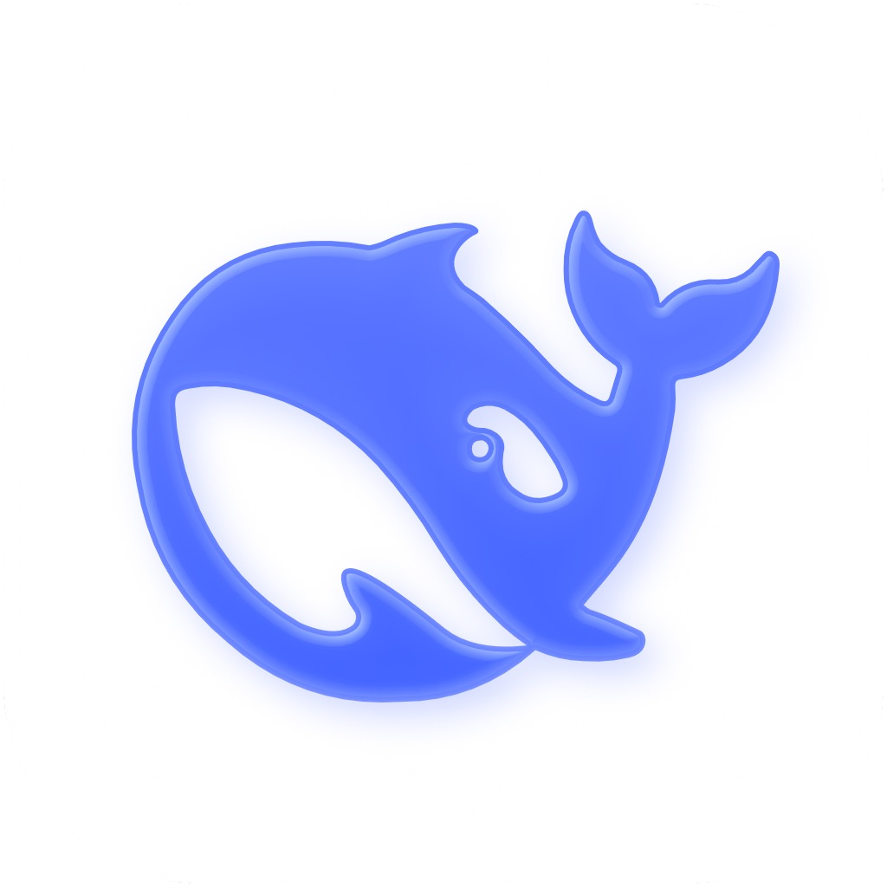

<div align="center">



# DeepSeek Desktop

**A local-first DeepSeek chat client for the web and the desktop.**

[](https://github.com/tangjiahui-cn/deepseek-desktop/releases)
[](LICENSE)
[](https://nodejs.org)
[](#desktop-app)

[Web app](https://tangjiahui-cn.github.io/deepseek-desktop/) · [Download](https://github.com/tangjiahui-cn/deepseek-desktop/releases) · [Features](#features) · [Development](#development)

English | [简体中文](README.md)

</div>

DeepSeek Desktop is a chat app powered by the DeepSeek API, available as a static web app and as a native desktop app for macOS, Windows, and Linux. There is no application backend: the client connects directly to the API service you configure.

> [!TIP]
> [Open the web version](https://tangjiahui-cn.github.io/deepseek-desktop/) or [download an installer](https://github.com/tangjiahui-cn/deepseek-desktop/releases). Add your API key in **Settings** before your first chat.

## Overview

The same React renderer runs in the browser and inside Electron, so the interface behaves the same everywhere. The desktop build loads from a fixed `app://deepseek` origin, keeping localStorage and IndexedDB stable across launches.

- **Local-first.** Settings live in localStorage; conversations, drafts, and original attachments live in IndexedDB. No account and no sync server.
- **No surprise updates.** The desktop app never downloads or installs anything until you ask it to.
- **One codebase, three platforms.** rspack builds the web bundle; electron-builder packages it for macOS, Windows, and Linux.

## Features

**Chat**

- Multiple conversations with automatic titles, rename, delete, and grouped history.
- Edit a prompt, regenerate a reply, and switch between message branches.
- In-chat search, plus ZIP export and import of all history.

**Answers**

- Streaming replies with **DeepThink** and **Search** toggles.
- Link reading with source citations, stop generation, and continue supported replies.
- Read aloud with a selectable voice.

**Input**

- Upload, paste, or drag and drop images, PDFs, Office files, text, and code.
- Voice input, with a live audio spectrum while recording on mobile.
- Unsent drafts and attachments survive window close on macOS.

**Rendering**

- GFM Markdown, syntax highlighting, KaTeX math, and Mermaid diagrams.
- Responsive layout with light, dark, and system themes.
- Simplified Chinese and English interfaces.

**Desktop**

- Native menus, single-instance handling, and restored window size and position.
- Attachment previews in an isolated window.
- Explicit update flow for Windows and Linux AppImage.

## Getting started

### Prerequisites

- Node.js **22.12 or newer** (24 LTS recommended)
- pnpm **11** — run `corepack enable` once to activate it
- Git

### Run locally

```sh
git clone https://github.com/tangjiahui-cn/deepseek-desktop.git
cd deepseek-desktop
pnpm install
pnpm dev
```

`pnpm dev` builds the Electron main process, starts the rspack dev server on port 8090, and opens the desktop window.

> [!NOTE]
> The first install downloads the Electron binary (100 MB+) and may take a few minutes.

### Web only

```sh
pnpm dev:web   # start the dev server at http://localhost:8090
pnpm build     # build the static site into dist/
```

Deploy `dist/` to any static host, or open `dist/index.html` directly. On `file://` pages, storage and cross-origin requests depend on the browser and the API's CORS policy. Voice input needs a secure context, so it does not work from `file://`.

## Desktop app

### Install

Download the artifact for your platform from [Releases](https://github.com/tangjiahui-cn/deepseek-desktop/releases):

| Platform | Artifact |
| --- | --- |
| macOS (Apple silicon / Intel) | `.dmg` or `.zip` |
| Windows x64 | NSIS `.exe` |
| Linux x64 | `.AppImage` or `.deb` |

### First launch

> [!WARNING]
> Current installers are **not code-signed or notarized**.
>
> - **macOS:** Gatekeeper blocks the first launch. Open **System Settings → Privacy & Security**, then click **Open Anyway**. If it is still blocked, run `xattr -dr com.apple.quarantine "/Applications/DeepSeek Desktop.app"`.
> - **Windows:** SmartScreen may warn about an unknown publisher. Choose **More info → Run anyway**.
> - macOS builds are ad-hoc signed so Apple silicon can launch them after approval. If an older build reports **"DeepSeek Desktop is damaged"**, download the latest release.

> [!NOTE]
> On macOS, **⌘W** or the red close button hides the window instead of quitting; the conversation, input draft, and attachments are preserved. Use **⌘Q** to quit completely.

### Updates

Updates are explicit: nothing is downloaded or installed until you choose to.

- When a newer stable release is available, a dismissible tag appears near the sidebar settings entry. Closing it hides that version until a newer one appears or you run **Check for Updates** from the menu.
- **Windows and Linux AppImage:** click **Update**, then **Restart and Install** when the download finishes. The app stops active replies, waits for local data to be written, then restarts into the new version.
- **macOS and Linux deb:** the tag opens the release page instead of installing in-app.
- Quitting during a download cancels it. Quitting with a downloaded update asks whether to install and quit or quit without installing.
- Release notes and version numbers come from the GitHub Release. Only stable, published releases are offered.

## Data and privacy

Your API key and settings are stored in localStorage. Conversations and original attachments are stored in IndexedDB. Local data is isolated by browser profile and site origin. Sending messages, uploading attachments, and using speech features sends the relevant content to the configured API service.

Desktop data lives in the platform application-data directory:

| Platform | Directory |
| --- | --- |
| macOS | `~/Library/Application Support/DeepSeek Desktop` |
| Windows | `%APPDATA%\DeepSeek Desktop` |
| Linux | `~/.config/DeepSeek Desktop` |

A development build uses a separate `DeepSeek Desktop (dev)` directory. The web version and the desktop app have different origins, so they keep separate histories. Use **Settings → Data → Export/Import** to move history between them as a ZIP archive.

> [!IMPORTANT]
> Importing a ZIP replaces all local conversations and attachments after validation. Exports include conversations and locally available original images, but exclude API keys, settings, and original non-image attachments. See the [history import/export documentation](src/services/chat/history/README.md) (Chinese) for the archive format and preservation details.

**Delete all chats** clears all local conversations, original attachments, and unsent drafts after confirmation. It stops ongoing replies and returns to a new chat. Your API key and settings are preserved; files already uploaded to the API service are not deleted.

## Development

| Command | Description |
| --- | --- |
| `pnpm dev` | Build the Electron main process, start rspack, and open the desktop app |
| `pnpm dev:web` | Start the rspack dev server only (http://localhost:8090) |
| `pnpm build` | Build the web renderer into `dist/` |
| `pnpm build:electron` | Build `electron/main.ts` and `electron/preload.ts` into `electron/dist/` |
| `pnpm build:desktop` | Build both the renderer and the Electron main process |
| `pnpm type` | Run TypeScript checks for the renderer and Electron code |
| `pnpm lint` | Lint with oxlint |
| `pnpm format` | Format with oxfmt |
| `pnpm dist:dir` | Package an unpacked app for the current platform |
| `pnpm dist:mac` | Build macOS dmg + zip for x64 and arm64 |
| `pnpm dist:win` | Build the Windows x64 NSIS installer |
| `pnpm dist:linux` | Build the Linux x64 AppImage and deb |

Packaging writes to `release/`. Windows and Linux targets are normally built in CI on their native runners, and the [desktop smoke checklist](docs/desktop-smoke-test.md) (Chinese) covers the pre-release manual checks.

### Project structure

```text
electron/
  main.ts              App lifecycle, single instance, window creation
  protocol.ts          app://deepseek static file protocol and CSP
  security.ts          Permissions, navigation, window.open, downloads
  preview.ts           Isolated attachment preview window
  windowState.ts       Window size/position persistence
  menu.ts              Application menu
  updater.ts           Explicit download/install update state machine
  preload.ts           Minimal contextBridge API
build/                 App icon and macOS entitlements
scripts/               Electron build and development launchers
src/
  app/                 Application layout, themes, and global styles
  components/          Chat, settings, Markdown, and other UI components
  i18n/                English and Chinese translations
  services/
    api/               API requests, SSE, and protocol types
    chat/              Conversations, message branches, storage, and history import/export
    desktop/           Desktop update bridge and types
    markdown/          Markdown parsing, syntax highlighting, and diagrams
    speech/            Audio recording and read-aloud playback
  utils/               Shared utilities
```

### Configuration

Chat uses `deepseek-flash` by default through Anthropic-compatible Messages / Files APIs. Speech features use ASR / TTS endpoints. Requests include extensions for search, link reading, titles, and `latest_reminder`, so the configured service must support the corresponding capabilities. Supported attachment formats are determined by server-side validation.

[rspack.config.ts](rspack.config.ts) uses `https://api.deepseek.com` by default. Use `createConfig({ apiOrigin, devServer })` to customize the API origin and development server proxy. The Electron main process gets the same origin at build time from `API_ORIGIN`.

### Security model

- The renderer runs sandboxed with `contextIsolation` on and `nodeIntegration` off.
- A Content Security Policy limits connections to the app origin and the configured API origin.
- Navigation away from the app origin is blocked; external links open in the system browser.
- Attachment previews use a separate window without the desktop bridge.

### Releasing

The desktop release workflow lives at [.github/workflows/release.yml](.github/workflows/release.yml). It runs on tags matching `v*` and can also be started manually with an existing tag.

```sh
# 1. Bump the version in package.json and commit the change
# 2. Create and push the tag
git tag v0.2.0
git push origin main --tags
```

The workflow checks that the tag matches `package.json`, builds macOS (x64 + arm64 dmg/zip), Windows x64 NSIS, and Linux x64 AppImage/deb in parallel, then publishes one GitHub Release with the installers and `latest*.yml` update metadata. Test tags containing `-` (for example `v0.2.0-test.1`) are marked as prereleases and are ignored by the updater.

Signing is optional. Without secrets the workflow publishes unsigned installers; with secrets it signs and notarizes automatically:

| Secret | Purpose |
| --- | --- |
| `MAC_CERT_P12` | Base64-encoded Developer ID Application certificate |
| `MAC_CERT_PASSWORD` | Password for the macOS certificate |
| `APPLE_ID` | Apple ID used for notarization |
| `APPLE_APP_SPECIFIC_PASSWORD` | App-specific password for notarization |
| `APPLE_TEAM_ID` | Apple Developer team ID |
| `WIN_CERT_P12` | Base64-encoded Windows code-signing certificate |
| `WIN_CERT_PASSWORD` | Password for the Windows certificate |

> [!WARNING]
> Never delete a published release that installed clients may use for updates; publish a fixed version instead.

## Tech stack

- [React 18](https://react.dev) and TypeScript, with Zustand for state
- [rspack](https://rspack.dev) with SWC and Lightning CSS for the renderer
- [Electron](https://www.electronjs.org) 45, electron-builder, and electron-updater
- [KaTeX](https://katex.org), [Mermaid](https://mermaid.js.org), and [Prism](https://prismjs.com) for rendering
- `idb` and `fflate` for local storage and ZIP archives

## Acknowledgements

This project is a fork of [DeepSeek's chat-demo](https://github.com/deepseek-ai/chat-demo). It adds the Electron shell, the desktop release pipeline, and the features described above.
