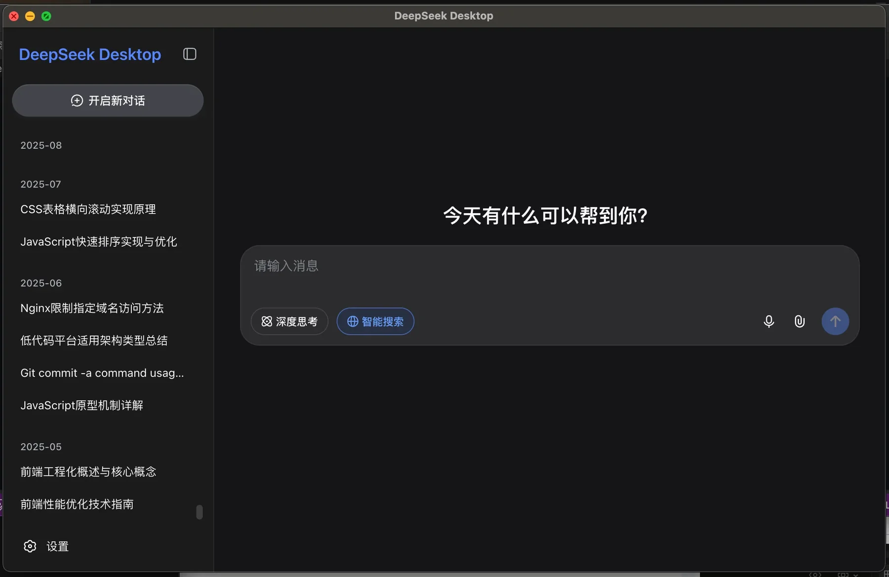

<div align="center">


# DeepSeek Desktop

**本地优先的 DeepSeek 聊天客户端，覆盖 Web 与桌面端。**

[](https://github.com/tangjiahui-cn/deepseek-desktop/releases)
[](LICENSE)
[](#桌面版)

[Web 版](https://tangjiahui-cn.github.io/deepseek-desktop/) · [下载](https://github.com/tangjiahui-cn/deepseek-desktop/releases) · [开发文档](docs/development.md)

简体中文 | [English](README.en.md)

</div>

DeepSeek Desktop 是基于 DeepSeek API 的聊天应用，同时提供静态 Web 版和 macOS / Windows / Linux 桌面版。应用没有自己的后端，客户端直接连接你配置的 API 服务；首次使用请在**设置**中填写 API Key。

- **本地优先：** 设置、会话、草稿与附件原件都保存在本地，无需账号。
- **个性化：** 在设置中保存一段自定义提示词，让回答更符合你的表达习惯。
- **长期记忆：** 可选开启，自动从新对话整理少量长期事实与偏好，并在后续对话中使用。
- **多端一致：** 同一份 React 界面运行在浏览器和 Electron 中。
- **更新可控：** 桌面版不会在未经确认时下载或安装更新。

## 截图（桌面端）



## 快速开始

需要 Node.js 22.12+（推荐 24 LTS）和 pnpm 11（`corepack enable`）。

```sh
git clone https://github.com/tangjiahui-cn/deepseek-desktop.git

cd deepseek-desktop

pnpm install

pnpm dev            # 启动桌面开发环境

pnpm dev:web        # 只启动 Web 开发服务器

pnpm build          # 构建 Web 静态产物到 dist/

pnpm dist:dir       # 打包当前平台
```

> [!NOTE]
> 首次安装需下载 Electron 二进制，可能耗时几分钟。

完整命令与配置见[开发文档](docs/development.md)。

## 桌面版

从 [Releases](https://github.com/tangjiahui-cn/deepseek-desktop/releases) 下载：

- **macOS**：`.dmg` / `.zip`
- **Windows x64**：`.exe`
- **Linux x64**：`.AppImage` / `.deb`

安装包未签名：macOS 首次启动需在系统设置中放行，Windows 需通过 SmartScreen 提示。

## 数据与隐私

API Key、设置、会话和附件都保存在本机。只有发送消息、上传附件或使用语音时，相关内容才会发送给你配置的 API 服务。

桌面端数据目录：

| 平台 | 目录 |
| --- | --- |
| macOS | `~/Library/Application Support/DeepSeek Desktop` |
| Windows | `%APPDATA%\DeepSeek Desktop` |
| Linux | `~/.config/DeepSeek Desktop` |

---

更多文档：[开发](docs/development.md) · [发布](docs/releasing.md) · [冒烟清单](docs/desktop-smoke-test.md)

[MIT](LICENSE) © 2026 DeepSeek
